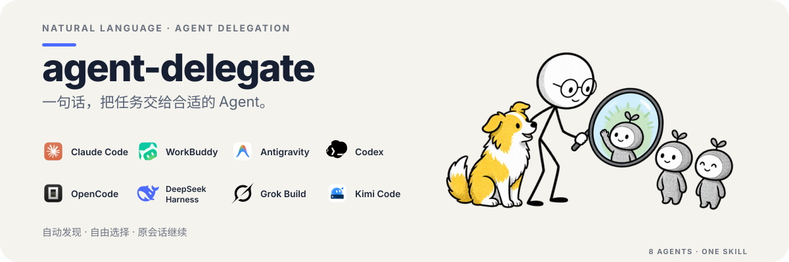
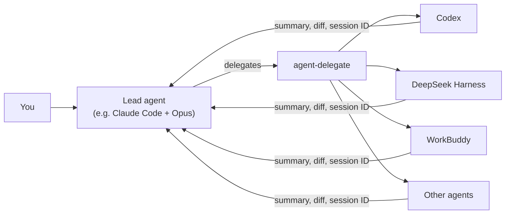

<p align="center">
  <a href="README.md">简体中文</a> · <b>English</b>
</p>

<p align="center">
  
</p>

<h3 align="center">Orchestrate multiple coding agents from one conversation.</h3>

<p align="center">
  Let Opus in Claude Code be the lead: design and planning.<br>
  Hand the actual work to Codex, DeepSeek Harness or WorkBuddy, and get the results back in the same conversation.
</p>

<p align="center">
  
  
  
  
</p>

## Why use it

- **Save the expensive model for judgement.** Planning, task breakdown and review stay with the strongest model; the bulk of reading and writing code goes to faster or cheaper models, and the lead conversation stays uncluttered.
- **No window switching.** Stop copying context and results between agents. Say one sentence, the task goes out, the result comes back, and you can follow up.
- **Get a second opinion from a different model.** Hand code review and design critique to another vendor, instead of letting a model review its own work.
- **Use the logins you already have.** It launches the CLIs installed on your machine, with their own accounts and quotas. No extra API keys, and it never reads or stores credentials.

## What you can do with it

Every example below is a sentence you type directly into an agent's chat. No commands to memorize.

### One lead plans, several agents execute

With Opus as the lead inside Claude Code:

```text
Design the user import feature first, and split it into independent tasks.
```

```text
Give tasks 1 and 2 to dsh, task 3 to codex. Each must run the tests, and you review the results.
```

The lead reads each agent's summary and the actual diff instead of writing all the code itself, which suits long tasks where you want to control Opus usage.

### The other way round: escalate the hard part

If you mostly work in Codex, WorkBuddy or DeepSeek Harness, you can still call Claude Code in for the problem you cannot pin down:

```text
We have failed to locate this concurrency bug in three rounds. Hand it to cc for a read-only root-cause analysis.
```

Any agent that can load skills can be the lead, and any of the eight can do the work.

### Independent review and critique

```text
Have codex review dsh's last change, read-only, and point out problems and risks.
```

```text
Before we start coding, have wb poke holes in this design.
```

Review tasks are read-only automatically, so your code stays untouched.

### Remember the assignment

```text
From now on, code review goes to codex and design review goes to cc.
```

Code review, design critique, hard-problem diagnosis (two models at once) and implementation each remember who handles them, after you say it once.

### Follow up or send it back

```text
dsh's last version missed the empty-file case. Have it continue and fix that.
```

The same agent resumes its original session, so you do not repeat the background.

## How it works



- agent-delegate is a skill. After reading its instructions, the lead agent runs the bundled Python script to launch the matching CLI.
- Every delegation leaves a full record: the original task, the summary and the raw output, for later inspection.
- You can set the model and reasoning effort for a single task, without touching each agent's own defaults.

## Supported agents

Full names and short names both work, case-insensitive:

| Agent | Short names and aliases |
| --- | --- |
| Claude Code | `cc`, `claude`, `claude-code` |
| WorkBuddy | `wb`, `workbuddy`, `codebuddy`, `cbc` |
| Codex | `codex` |
| DeepSeek Harness | `dsh`, `deepseek`, `deepseek-harness` |
| Antigravity | `agy`, `antigravity` |
| OpenCode | `opencode` |
| Grok Build | `grok`, `grok-build` |
| Kimi Code | `kimi`, `kimi-code` |

WorkBuddy, Codex and DeepSeek Harness have been used for real tasks on Windows; the others are adapted from their official documentation and covered by automated tests. If your agent misbehaves, please [open an issue](https://github.com/Wexexortexort/agent-delegate/issues).

## Installation

### Requirements

- **OS**: developed and tested on Windows 10/11. macOS and Linux inherit the original design and should work, but this project has not been tested on them.
- **Python 3.10 or newer**: run `py -3 --version` in a terminal (use `python3 --version` on macOS / Linux) and check that it prints a version.
- **At least one agent from the list above**, installed and logged in.

### Install the skill

The simplest way is to send this sentence to your agent:

```text
Please install this skill: https://github.com/Wexexortexort/agent-delegate
```

Or install it from the command line:

```bash
npx skills add Wexexortexort/agent-delegate
```

Then reload the skills (or restart the agent).

### First use

On the first delegation it scans which agents are installed on your machine, then asks you two things:

1. Which agents should be enabled?
2. Which one is the default, or should it ask every time?

Nothing is saved until you confirm. The scan does not call any model, install software, or log you in. If an agent is not logged in or unavailable, it tells you so.

## FAQ

<details>
<summary><b>How is this different from Claude Code's built-in subagents?</b></summary>

A built-in subagent still uses the same vendor's model and the same quota. agent-delegate launches a separate CLI: a different vendor's model, its own tools and its own account quota. That is what makes "a second opinion from a different model" and "offloading work to a cheaper model" possible.

</details>

<details>
<summary><b>Does it actually save money?</b></summary>

It depends on how you split the work and on each vendor's pricing. When the lead only reads summaries instead of writing all the code itself, usage of the most expensive model usually drops a lot; the executing agents are billed too. Try it on one small task and compare.

</details>

<details>
<summary><b>Do I need to configure API keys?</b></summary>

No. It launches the CLIs you have already logged into on your machine, using their own login state and settings.

</details>

<details>
<summary><b>Can it be installed alongside the original oil-delegate?</b></summary>

Yes. The two have different names and do not interfere, and they share one configuration directory (`~/.oil-delegate`): agents and preferences chosen in one are available in the other. Note that the original companion skills (such as `oil-plan` and `oil-code-review`) only call `oil-delegate`.

</details>

## Notes

- **Cost**: task content is sent to the agent you choose and its model provider, which may incur charges. Never put secrets in a task.
- **Permissions**: ordinary tasks use each agent's highest permission level by default, so an unattended run does not stall on approvals. That means the agent can edit files and run commands. For important projects, scope the task first, then review the diff and rerun the tests. Say "read-only" when you want that.
- **Verification**: an agent reporting "done" is not proof. The diff and the test results are.

For when it pays to delegate and how to split roles, see [How to use subagents well](https://book.oiloil.org/articles/subagent-workflow?utm_source=github&utm_medium=referral&utm_campaign=oil-delegate-readme) in the Oil Book.

<details>
<summary>Maintenance, tests and troubleshooting</summary>

Run the regression tests (they never call an external model):

```bash
py -3 -m unittest discover -s tests -p "test_*.py" -v
```

On macOS / Linux, replace `py -3` with `python3`.

Per-agent invocation details and failure handling are in the [runner reference](references/runners.md). When reporting a problem, include the agent name, its version and the error message.

</details>

## Acknowledgements and upstream

This project is based on [oil-oil/oil-delegate](https://github.com/oil-oil/oil-delegate). The core design, the multi-agent adapters and the interaction flow all come from the original author [oil-oil](https://github.com/oil-oil). Thank you for the open-source work.

Compared with the original, this project mainly adds Windows compatibility (multi-line tasks are no longer truncated, and output is read correctly on Chinese Windows) and lets a single task override the model and reasoning effort. See the [CHANGELOG](CHANGELOG.md) for each change. This project keeps merging upstream updates, and generally useful fixes are submitted upstream as well, for example [oil-oil/oil-delegate#9](https://github.com/oil-oil/oil-delegate/pull/9).

## License

[MIT License](LICENSE). The original author's copyright notice is preserved in the LICENSE file. See the [asset notice](assets/readme/NOTICE.md) for icon and illustration sources.
