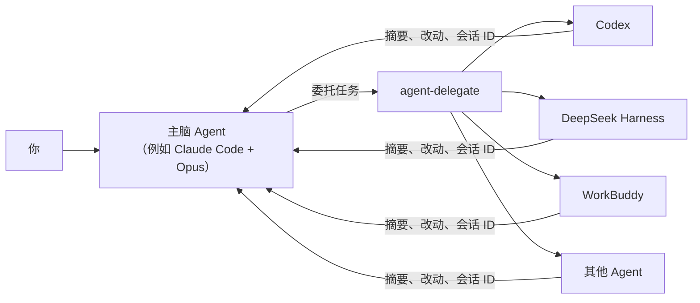

<p align="center">
  <b>简体中文</b> · <a href="README.en.md">English</a>
</p>

<h3 align="center">在一个对话里调度多个 Agent。</h3>

<p align="center">
  让能力更强的模型做主脑（比如 Claude Code + Opus 5.5），负责设计、规划和验收；<br>
  具体的活儿交给 Codex、DeepSeek Harness 等分头去做，结果自动回到当前对话。<br>
  验收不通过，主脑会指出问题，让它在原会话里接着返工。
</p>

<p align="center">
  <a href="https://github.com/Wexexortexort/agent-delegate/actions/workflows/tests.yml"></a>
  
  
  
  
</p>

## 为什么用它

- **贵的模型只做判断**：规划、拆任务、验收留给最强的模型，大量读代码、写代码交给更快或更便宜的模型，主对话的上下文也更干净。
- **不用切窗口**：不用在几个 Agent 之间来回复制背景和结果。说一句话，任务就交出去了，结果带回来，还能接着追问。
- **换一家模型看问题**：代码审查、方案挑刺交给另一家模型，避免“自己写、自己审”。
- **沿用你已有的登录**：直接调用本机装好的各家 CLI，用它们自己的账号和额度。不需要额外的 API Key，也不读取、不保存任何密钥。

## 使用场景

下面的例子都是在 Agent 的对话框里直接说的话，不需要记命令。

### 主脑规划，多个 Agent 分工执行

在 Claude Code 里让 Opus 做主脑：

```text
先帮我设计用户导入功能的方案，拆成几个独立的小任务。
```

```text
第 1、2 个任务交给 dsh 写，第 3 个交给 codex 写。每个都要跑测试，做完你来验收。
```

主脑读的是每个 Agent 交回的摘要和实际改动，而不是从头到尾自己写代码，适合想控制 Opus 用量的长任务。

### 反过来：把难题交给更强的模型

主要在 Codex、WorkBuddy 或 DeepSeek Harness 里干活，遇到想不清楚的地方，再请 Claude Code 出主意：

```text
这个并发问题我们查了三轮都没定位，交给 cc 只读分析一下根因。
```

任何能加载 Skill 的 Agent 都可以做主脑，执行方也可以是这 8 个里的任意一个。

### 独立审查与方案挑刺

```text
让 codex 只读审查 dsh 刚才的改动，指出问题和风险。
```

```text
动手之前，让 wb 挑一挑这个方案的毛病。
```

审查类任务自动只读，不会改你的代码。

### 记住分工，以后不用再说

```text
以后代码审查都交给 codex，方案评审交给 cc。
```

代码审查、方案挑刺、疑难会诊（两个模型同时看）、功能实现，各自交给谁，说一次就记住。

### 接着追问或返工

```text
dsh 刚才那版漏了空文件的情况，让它接着改。
```

同一个 Agent 会接着原来的会话继续，不用重复背景。

## 工作方式



- agent-delegate 是一个 Skill，主脑 Agent 读了说明后，会调用随附的 Python 脚本去启动对应的 CLI。
- 每次委托都会留下完整记录：任务原文、结果摘要、原始输出，方便事后查看。
- 可以给单次任务指定模型和思考强度，不影响各 Agent 自己的默认设置。

## 支持的 Agent

全名或简称都可以，不区分大小写：

| Agent | 简称与别名 |
| --- | --- |
| Claude Code | `cc`、`claude`、`claude-code` |
| WorkBuddy | `wb`、`workbuddy`、`codebuddy`、`cbc` |
| Codex | `codex` |
| DeepSeek Harness | `dsh`、`deepseek`、`deepseek-harness` |
| Antigravity | `agy`、`antigravity` |
| OpenCode | `opencode` |
| Grok Build | `grok`、`grok-build` |
| Kimi Code | `kimi`、`kimi-code` |

在 Windows 上已用 WorkBuddy、Codex、DeepSeek Harness 跑过真实任务；其余 Agent 按官方文档适配，有自动化测试覆盖。如果你用的 Agent 出了问题，欢迎到 [Issues](https://github.com/Wexexortexort/agent-delegate/issues) 反馈。

## 安装

### 准备

- **系统**：主要在 Windows 10/11 上开发和实测。macOS、Linux 沿用原版的设计，理论上可以使用，但本项目没有在这两个系统上实测。
- **Python 3.10 或更高版本**：在终端运行 `py -3 --version`（macOS / Linux 用 `python3 --version`）能看到版本号即可。
- **至少一个已安装并登录的 Agent**：见上面的列表。

### 安装 Skill

最简单的方式是把下面这句话发给你的 Agent：

```text
请帮我安装这个 Skill：https://github.com/Wexexortexort/agent-delegate
```

也可以用命令安装：

```bash
npx skills add Wexexortexort/agent-delegate
```

装好后重新加载 Skill（或重启 Agent）即可。

### 第一次使用

第一次委托时，它会自动检查本机装了哪些 Agent，然后只问你两件事：

1. 要启用哪些 Agent？
2. 默认用哪一个，还是每次再选？

你确认后才会保存。检查过程不调用模型、不安装软件、不替你登录。某个 Agent 没登录或不可用时，它会如实告诉你。

## 常见问题

<details>
<summary><b>和 Claude Code 自带的子 Agent 有什么区别？</b></summary>

自带的子 Agent 用的还是同一家模型、同一份额度。agent-delegate 调用的是另一个独立的 CLI：另一家的模型、它自己的工具和账号额度。所以它能做到“换个模型看问题”，也能把工作量分到更便宜的模型上。

</details>

<details>
<summary><b>真的能省钱吗？</b></summary>

取决于你怎么分工和各家的定价。主脑只读摘要、不亲自写大量代码时，最贵模型的用量通常会明显下降；但执行方的用量同样计费。建议先在一个小任务上对比一下。

</details>

<details>
<summary><b>需要配置 API Key 吗？</b></summary>

不需要。它直接调用你本机已经登录好的各家 CLI，用的是它们自己的登录状态和设置。

</details>

<details>
<summary><b>可以和原版 oil-delegate 一起安装吗？</b></summary>

可以，两者名字不同，互不影响，并且共用同一个配置目录（`~/.oil-delegate`）：在一边选好的 Agent 和偏好，另一边也能直接用。注意：原版的配套 Skill（如 `oil-plan`、`oil-code-review`）只会调用 `oil-delegate`。

</details>

## 注意事项

- **费用**：任务内容会发给你选的 Agent 及其模型服务，可能产生费用。不要在任务里写密钥。
- **权限**：普通任务默认使用各 Agent 的最高权限，避免无人值守时卡在审批上。这意味着 Agent 可以改文件、执行命令。重要项目请先限定范围，事后检查改动并重跑测试。需要只读时直接说“只读”。
- **验收**：Agent 自己说“完成了”不算数，以实际改动和测试结果为准。

关于什么场景适合派发子 Agent、不同角色怎么分工，可以参考 Oil Book 里的[《怎样用好子 Agent》](https://book.oiloil.org/articles/subagent-workflow?utm_source=github&utm_medium=referral&utm_campaign=oil-delegate-readme)。

<details>
<summary>维护、测试与排查</summary>

运行回归测试（不会调用任何外部模型）：

```bash
py -3 -m unittest discover -s tests -p "test_*.py" -v
```

macOS / Linux 把 `py -3` 换成 `python3`。

各 Agent 的调用细节和失败处理见 [Runner 适配参考](references/runners.md)。反馈问题时请附上 Agent 名称、版本和错误信息。

</details>

## 致谢与上游

本项目基于 [oil-oil/oil-delegate](https://github.com/oil-oil/oil-delegate)。核心设计、多 Agent 适配和交互流程都来自原作者 [oil-oil](https://github.com/oil-oil)，感谢原作者的开源工作。

和原版相比，本项目主要补充了 Windows 上的兼容性（多行任务不再被截断、中文系统下正确读取输出），并支持给单次任务指定模型和思考强度。每次改动见 [CHANGELOG](CHANGELOG.md)。本项目会持续同步上游更新，通用的修复也会提交给上游，例如 [oil-oil/oil-delegate#9](https://github.com/oil-oil/oil-delegate/pull/9)。

## License

[MIT License](LICENSE)。原作者版权声明保留在 LICENSE 中。配图来源见[素材说明](assets/readme/NOTICE.md)。
